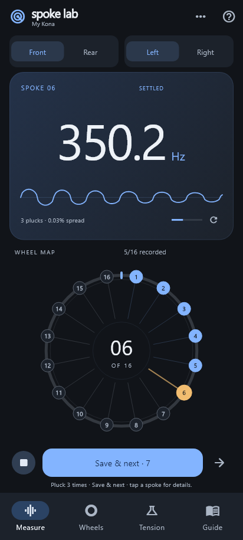
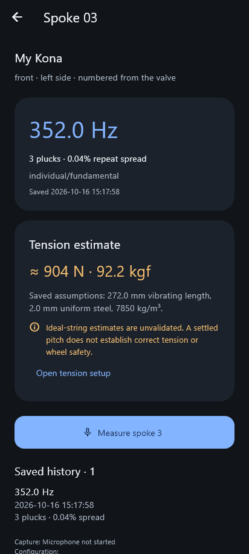
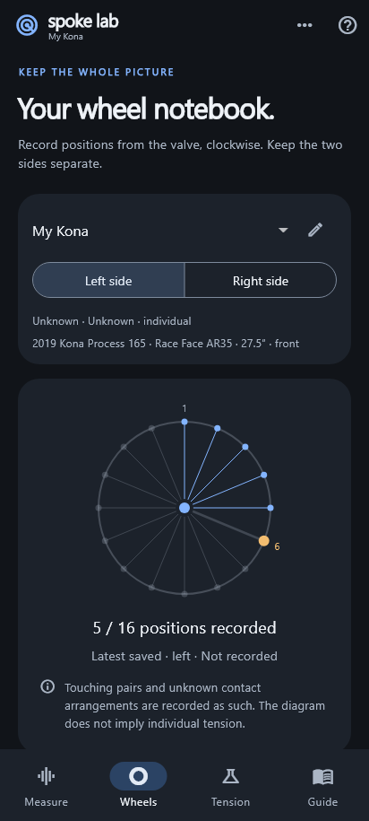
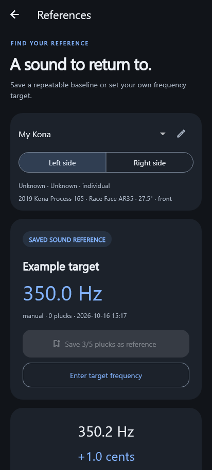
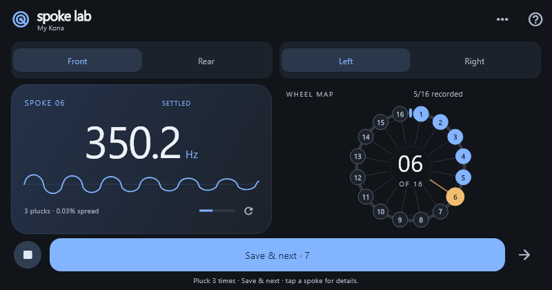
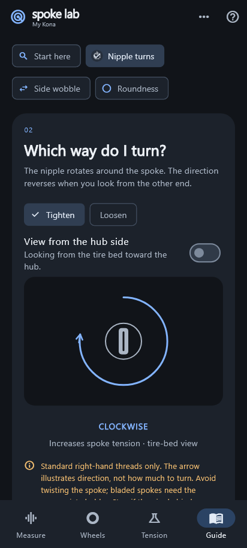
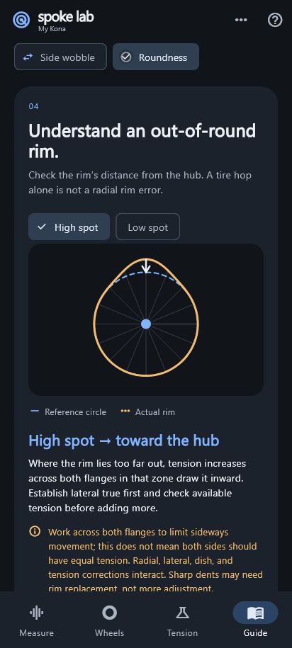

# Spoke Lab

An offline Flutter Android app that listens to bicycle spokes, measures their frequency, and maps saved readings to a wheel. Pluck, let the reading settle, then save and move to the next spoke. **Version 0.1 is a frequency/reference beta. It does not provide validated tension measurements or certify wheel safety.**

## Screenshots

The graphite and blue theme keeps Measure focused on frequency, waveform, and
the wheel map. Amber highlights the selected spoke and cautions.

| Measure and map | Inspect a saved spoke |
| --- | --- |
|  |  |

| Wheel profiles | Sound references |
| --- | --- |
|  |  |



 

These previews render actual Flutter widgets with synthetic readings and host
fonts. They are not phone captures or evidence of measurement accuracy. See the
[complete screenshot gallery](docs/previews/README.md) and [theme research](docs/THEME.md).

## Features

- **Illustrated Guide:** an offline workshop page for tire-versus-rim checks, viewpoint-dependent nipple rotation, lateral wobble, and radial high/low spots. Interactive diagrams share the current theme; access Guide from navigation, the help icon, or tools. See the [guide research](docs/WHEEL_GUIDE.md).
- **Measure:** one fixed screen with frequency and waveform above an interactive numbered wheel. Repeated plucks settle to a median estimate; **Save & next** stores the selected spoke and advances while keeping the microphone open. Front/rear and left/right switches select independent maps. Tap a spoke to inspect its history or measure it again. See the [wheel-mapping workflow](docs/WHEEL_MAPPING.md).
- **Sound references:** under the top-right tools menu, save five consistent plucks or enter a target frequency; compare Hz, percentage and cents within the same wheel-side configuration.
- **Wheels:** front/rear profiles for material, round/butted/bladed dimensions, contact arrangement and tire state; persistent indexed readings, sessions, history and CSV/JSON export. Preset selection and editing live here and in the tools menu.
- **Calibration:** collect known-force observations and inspect an experimental quadratic fit. Adding observations never enables validated tension measurements in this version.
- **Bike preset:** under Wheels → Add wheel, select Kona Process 165 (2019) with Race Face AR35 27.5-inch replacement rims (fitted around 2021). Select front/rear and confirm the spoke count. It does not assign unknown spoke dimensions or a frequency target. See the [preset research](docs/KONA_PROCESS_165_PRESET.md) and [screen preview](docs/previews/kona-preset.png).
- **Experimental tension:** a separate **Tension** page contains setup and calculations; saved spoke details show any estimate attached to that reading. The setup button selects an existing Kona wheel or opens a new profile with that preset selected. The explicitly unvalidated ideal-string model starts with the owner's **272 mm** vibrating length and assumes uniform **2.0 mm steel, 7850 kg/m³**. Apply assumptions separately to each wheel side. Confirm individual contact in the profile and capture three consistent, two-window harmonic-supported fundamentals; unknown/coupled contact, short decays, spectral peaks and conflicting spoke specifications retain frequency-only behavior. Estimates and assumptions accompany saved readings and exports. See the [calculator details](docs/KONA_PROCESS_165_PRESET.md#experimental-tension-calculator).

No account, server, paid service or runtime network access is needed. Audio is processed locally and discarded; only measurement metadata and frequency summaries are saved. Uninstalling removes local data: export anything you want to keep. JSON export is an archive; import is not implemented.

## Measure your wheel

1. Create or select a profile under **Wheels**. Presets and additional tools are also in the top-right menu.
2. Select front/rear and left/right on **Measure**. Number spokes clockwise from the valve, viewed from the selected side; a 32-spoke wheel normally has 16 indexed positions per side in this app.
3. Keep the wheel stationary and unloaded. Start listening in a quiet space, hold the phone near the spoke without touching it, and pluck gently.
4. Let each ring decay and repeat the same spoke until **SETTLED** appears. Choose **Save & next** to record it, or use the arrow to skip without saving.
5. Tap a numbered spoke for its details or to measure it again. Find **Sound references**, **Calibration**, and **Capture settings** in the tools menu; calculation settings are on **Tension**.

Saved and settled states describe data capture and repeatability; they do not establish correct tension. See the [wheel-mapping guide](docs/WHEEL_MAPPING.md).

## Run on Android

Developed with Flutter 3.44.9 / Dart 3.12.2, Java 17-compatible Android tooling and Android API 24 or newer (the installed Flutter SDK's minimum). Initial dependency downloads need internet access.

```sh
flutter doctor
flutter pub get
flutter devices
flutter run -d <android-device-id>
```

Open the repository root in Android Studio with the Flutter and Dart plugins enabled, and choose an Android device as the run target. Use USB debugging on a real phone for acoustic tests. A simulator is insufficient for microphone and physical validation. See [device validation](docs/DEVICE_VALIDATION.md) before using a wheel.

```sh
dart format lib test integration_test test_driver tools/direct_test_runner.dart
flutter analyze
flutter test
flutter test integration_test/app_test.dart -d <android-device-id>
flutter build apk --debug
```

The debug APK normally appears at `build/app/outputs/flutter-apk/app-debug.apk`. A diagnostic update was installed and opened on the owner's OnePlus 15 (CPH2745, Android 16); the owner confirmed microphone-level movement and prompt frequency detection. The diagnostic update reused the existing debug APK's native code with a newly compiled Dart kernel because this session cannot run the normal Flutter build. That initial check preceded the latest dashboard/theme, which has not yet been verified on the phone. Full device integration tests and physical accuracy validation remain outstanding. Release signing still uses the Flutter template's debug key; configure your own signing before distribution.

If Flutter's runner cannot start child processes on Windows, a diagnostic fallback executes the same unit/widget tests directly in Flutter's engine:

```powershell
.\tools\Run-DirectTests.ps1 -FlutterSdk C:\flutter
```

This fallback uses test framework internals, supports the current tests, and does not replace device integration tests or a normal build.

## Verification status

- **70 unit/widget tests pass**, covering DSP, persistence, microphone lifecycle, wheel mapping, and compact/large-text/landscape layouts.
- Static analysis is clean. The updated screenshot gallery renders from the current Flutter widgets with injected example data.
- The checked core theme text/surface pairs exceed **4.5:1** contrast; this is not a full accessibility-conformance claim.
- Physical frequency error, mechanical tension accuracy, and full device integration tests remain unverified. See [device validation](docs/DEVICE_VALIDATION.md).

## Measurement assumptions

Capture uses mono PCM16 at 48 kHz, with 44.1 kHz fallback. Android `UNPROCESSED` is preferred where advertised; otherwise `VOICE_RECOGNITION` is requested. Live analysis examines one rolling 8192-sample window, advances by 4096 samples and displays clear peaks over approximately **50–3000 Hz**. Its first window represents about 171–186 ms of audio, plus processing/device latency. An unconfirmed live value expires after 1.5 seconds. Once at least three separately detected plucks agree, Measure holds their median rather than following each overlapping live frame.

Saved readings require three consistent, separately detected plucks in **80–2500 Hz** (at most 1.5% sample relative standard deviation); five permit a recorded sound reference. A clean short decay may contribute a frequency-only result when its second window is too quiet. If a repeat set mixes confirmation levels, it stays frequency-only. Tension retains the stricter two-window fundamental requirement. Sensitive, Balanced and Noisy room settings are in **tools → Capture settings**. These are provisional engineering thresholds; digital dBFS is not acoustic sound pressure. See the [responsiveness investigation](docs/RESPONSIVE_AUDIO.md) for implementation and validation limits.

An ideal uniform string obeys `T = 4 μ L² f²`; actual spokes introduce stiffness, end constraints and crossing interactions. A good tone match cannot establish correct tension. Research, citations and the original validation proposal are in [PHASE_1_PLAN.md](PHASE_1_PLAN.md).

## Source map

| Path | Responsibility |
| --- | --- |
| `lib/core/audio/`, Android `MainActivity.kt` | Audio capture and platform channels |
| `lib/core/dsp/`, `lib/core/physics/` | Signal analysis and research mathematics |
| `lib/app/`, `lib/features/` | ChangeNotifier controller, screens and profile editor |
| `lib/data/` | Immutable records, JSON persistence and exports |
| `test/`, `integration_test/` | Software checks and device smoke test |

See [implementation and validation status](docs/IMPLEMENTATION_STATUS.md) for passed checks, remaining work and design decisions. Contributor instructions are in [AGENTS.md](AGENTS.md).
