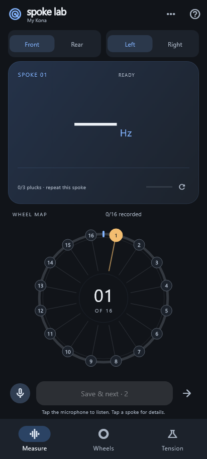
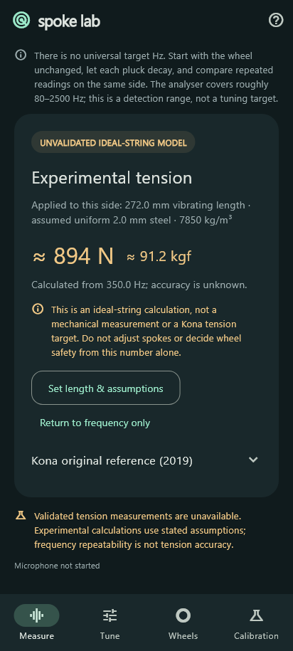
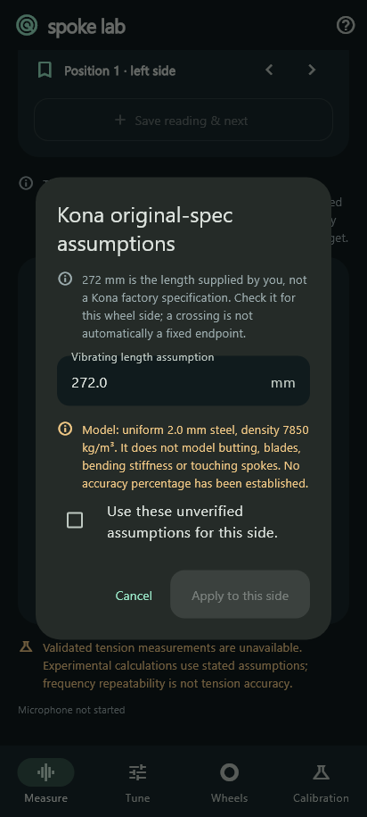
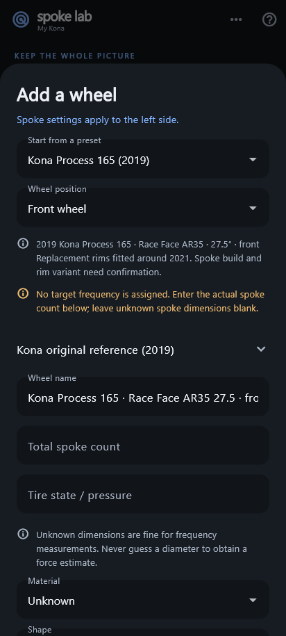
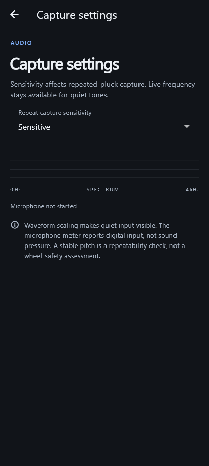
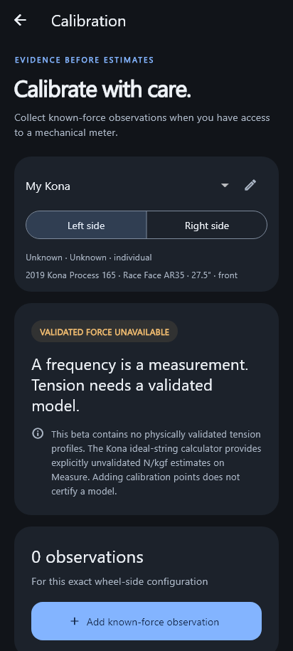

# Screenshot Gallery

These images render the current Flutter widgets in the graphite and blue theme.
Measurements are synthetic examples; the reference target is manually entered.
Host fonts differ from Android. These are UI previews, not phone captures,
accuracy tests, or evidence of safe spoke tension.

## Measure

| Ready to listen | Settled reading and wheel map |
| --- | --- |
|  |  |

## Spoke details and tension

| Saved spoke details | Separate Tension page |
| --- | --- |
|  |  |

`measure-tension.png` is retained as a compatibility filename for existing links;
it shows the separate Tension page.

## Wheel setup and references

| Wheel profiles and records | Kona preset setup |
| --- | --- |
|  |  |

| Sound references | Capture sensitivity |
| --- | --- |
|  |  |

## Calibration evidence collection

See [theme research](../THEME.md), [wheel mapping](../WHEEL_MAPPING.md), and
[device validation](../DEVICE_VALIDATION.md). Return to the
[project README](../../README.md).
